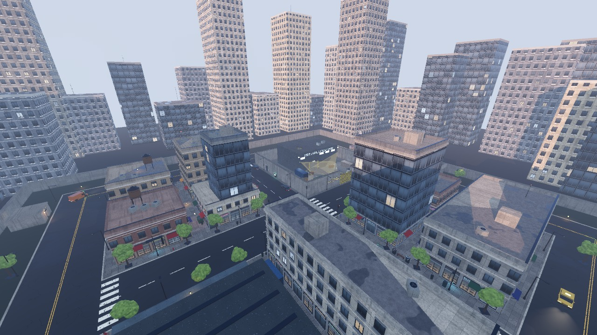
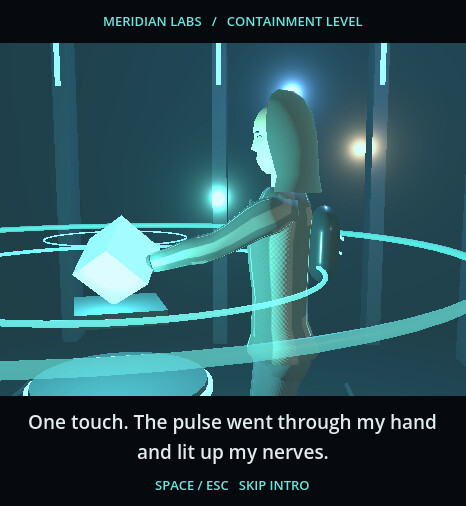
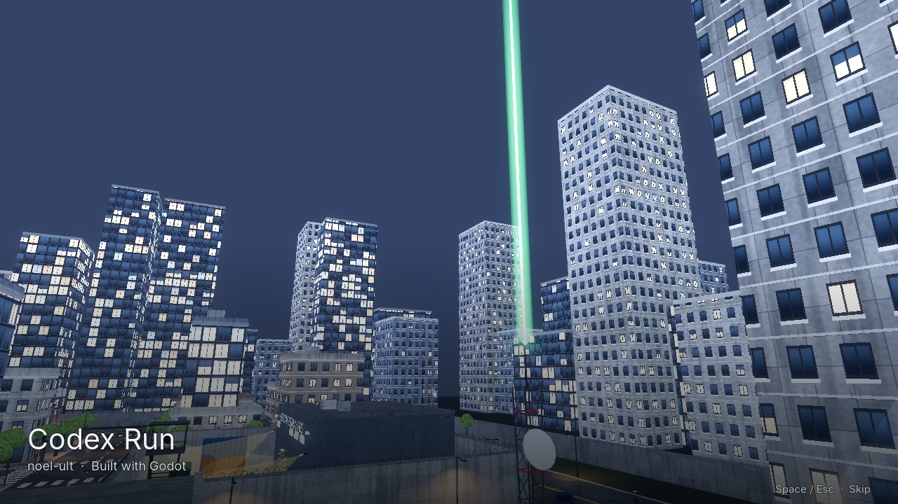
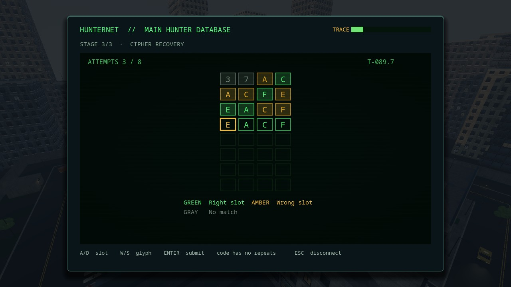
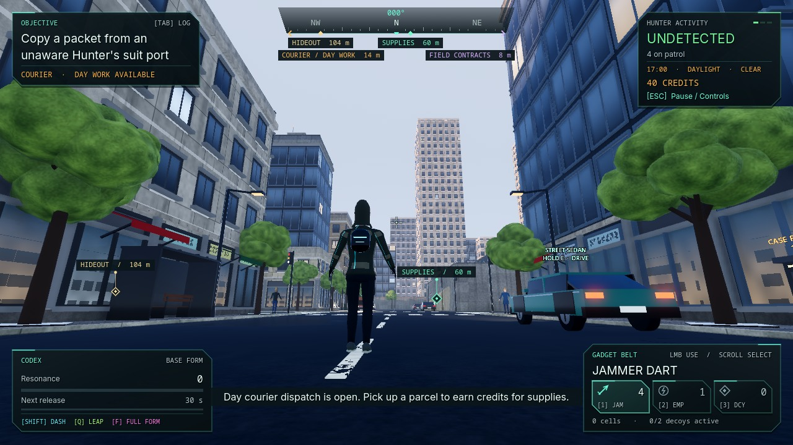

# Codex Run

Codex Run is a third-person stealth heist in an open city. As the Runner, steal HunterNet credentials, infiltrate Meridian Signal Labs and transmit the Codex before the Hunters close in. The project is a playable Godot 4 vertical slice built with typed GDScript and procedural visuals.



## Contents

- [Run locally](#run-locally)
- [Opening and judging demo](#opening-and-judging-demo)
- [Play the heist](#play-the-heist)
- [Controls and HUD](#controls-and-hud)
- [Stealth and security](#stealth-and-security)
- [City systems](#city-systems)
- [Project architecture](#project-architecture)
- [Development and verification](#development-and-verification)

## Run locally

Use **Godot 4.7**. The project was verified on **4.7.2** and uses the **Forward+** renderer.

```bash
git clone https://github.com/noel-ult/codex_runv2.git
cd codex_runv2
godot --headless --path . --import
godot --path .
```

In the editor, import `project.godot` and press **F5**. The game starts in `res://scenes/main.tscn`. The import step generates the local `.godot/` cache required by GDScript’s `class_name` types.

## Opening and judging demo

The 23-second opening cutscene follows the Runner into Meridian Labs, through first contact with the Codex, and into the aftermath. Press **Space** or **Esc** to skip. The game restores your checkpoint after the intro ends.



To preview the ending, press **Ctrl+Shift+F10** during active on-foot gameplay. The demo moves the Runner to the live relay and runs a six-second upload with capture disabled, followed by the finale cinematic and result screen. Demo progress cannot be saved, and **R** clears the existing checkpoint.

## Play the heist

### Main mission

You carry the **Codex**. Send it to safety through the Hunters’ own uplink.

1. **Copy and decode HunterNet.** Sneak up behind an *unaware* (green-visor) Hunter and hold **E** on its suit port to copy an encrypted packet. You can keep moving after copying. Carry it to **Storage 07** on the west edge and hold **E** at the indoor **HunterNet decoder** to start Signal Lock in shelter. Win to recover lab credentials and automatically save a checkpoint. Escape leaves the packet available for another attempt.
2. **Infiltrate Meridian Signal Labs** (the walled compound in the NE block) and authenticate at the **HunterNet core** door with the credentials.
3. **Breach the Main Hunter Database** in three retro layers on the CRT terminal: **Signal Lock**, then **Firewall Override**, then **Cipher Recovery**. Mistakes raise the **TRACE** meter. At 100%, HunterNet raises the alarm and locks the terminal for 20 s.
4. **Lockdown.** A successful breach reveals the live relay and triggers HunterNet lockdown. The Hunters converge, the relay guard doubles, and the base Codex Release interval drops to 20 s. Before starting the uplink, you can use the violet relay marker to send a false handshake and divert up to two Hunters for 24 seconds.
5. **Transmit.** Hold **E** at the live relay and spend **50 seconds** within **16 metres** while the uplink broadcasts your position. Moving out of range pauses progress.

### Finale and end credits

When the upload reaches 100%, the camera lifts from the live relay mast into the city skyline along the beam. Credits fade in over the scene during the roughly 12-second cinematic, then the **Codex Transmitted** result screen appears. Press **Space** or **Esc** to skip to the result. Press **R** to play again. After a regular mission, press **Ctrl+S** to save completion. Loading a completed checkpoint goes directly to the result.



### Checkpoint and capture

Decoding the credentials at Storage 07 saves automatically. Press **Ctrl+S** to save the latest completed objective at any of the following points.

| Milestone | Objective on resume |
| --- | --- |
| Suit packet copied | Take the packet to Storage 07 and decode it. |
| Credentials decoded | Head to Meridian Labs and open the core. |
| Core opened | Breach the Main Hunter Database. |
| Database breached | Head to the live relay and start the upload from zero. |
| Upload complete | Return to the completion screen. |

Capture ends any active hack or upload and restores the saved objective. Before decoding, you respawn at the original starting point. After decoding, you respawn inside Storage 07 with your credentials. Gear, upgrades and credits survive capture. Relaunching restores the objective and live relay selection with starting inventory and credits, plus the decode salvage reward if earned. Press **R** or confirm **Restart Run** to clear the checkpoint.

### Terminal minigames

| Stage | How to play |
| --- | --- |
| **Signal Lock** | Use A/D to tune frequency and W/S to tune phase. Match the drifting carrier and hold the lock. |
| **Firewall Override** | Follow three prompts by pressing the displayed number key (1, 2 or 3). Each wrong key adds 10% trace. |
| **Cipher Recovery** | Use A/D to pick a tile, W/S to cycle through `3`, `7`, `A`, `C`, `E` and `F`, then press Enter to submit. You have eight attempts at the database terminal. An incorrect row adds 5% trace. |

Cipher Recovery uses Wordle-style clues on each submitted tile. **Green** means the glyph is in the right slot, **amber** means it belongs in another slot, and **gray** means the tile has no match. The secret has four distinct glyphs. If a guess repeats a glyph, only one tile can match it, with exact matches scored first.



## Controls and HUD

### Default controls

| Key | Action |
| --- | --- |
| W/A/S/D or arrow keys | Move on foot or drive and steer a vehicle |
| Mouse | Camera |
| Space | Jump, or press again in the air to Leap. Brake while driving or skip the intro or credits. |
| Q | Leap from the ground |
| Shift | **Dash** |
| F | Toggle **Full Form** |
| C / Ctrl | Toggle **crouch** |
| Z | Toggle **prone** (lie down and crawl) |
| E (hold) | Use a nearby interaction, such as a suit port, terminal, vehicle door or shop |
| E (tap) | Leave a vehicle once stopped |
| Left mouse | Use the selected gadget |
| 1 / 2 / 3, mouse wheel | Select Jammer Dart / EMP Charge / Decoy Codex |
| Tab | Toggle the objective log |
| Ctrl+S | Save the latest completed mission objective |
| R | Restart Run (clears the mission checkpoint) |
| Esc | Pause or resume play, skip the intro or credits, or leave the open terminal, workbench or shop |

Open **Esc → Controls** to check the current bindings for gameplay, terminal minigames, and the workbench. **Esc → Operators** lets you inspect the Runner, Hunter, Civilian, and Technician in 3D. Drag the model to rotate it, or use the left and right arrows while the preview has focus.

The pause menu’s **Graphics** selector saves your choice across runs. **Detail** uses full resolution and the complete lighting effects. **Performance** renders the 3D view at 80% scale and turns off screen space reflections, ambient occlusion, and volumetric fog. HUD text stays at full resolution.

### HUD



| Area | Contents |
| --- | --- |
| Top centre | Heading tape with objective bearings and distances |
| Top left | Current objective (Tab for the full log) |
| Top right | Threat state (UNDETECTED / SEARCHING / HUNTED), with a matching screen-edge vignette |
| Bottom left | Form, Resonance, Codex Release countdown, ability keys and status chips (stance, ignition, dead zone, disguise timer, lockdown) |
| Bottom right | Selected gadget, ammo, cells and decoys |
| Centre | World markers, jammer target lock, and interaction prompts with a hold bar |
| Bottom centre | Radio subtitles |

## Stealth and security

### The Codex

- **Base Form**: slow and invisible to Hunters. They only know where you are from signals.
- A **Codex Release** vents a pulse every **30 s** under normal nighttime conditions. The pulse pings every Hunter within a radius that grows with Resonance. The HUD shows the countdown at the bottom left. Dead Zones absorb it, an armed decoy can take it for you, and a disguise shrinks its radius.
- **Micro-Fusions** (Dash, Leap) and **Full Form** (fast, high jumps) build **Resonance**. Reaching 100 triggers **Ignition**: your live position is broadcast and Residual Echoes drop behind you.
- **Dead Zones** (violet haze): the East Tunnel, the SW Warehouse and the Faraday-shielded HunterNet core. They mask broadcasts and Releases, and Resonance decays 3× faster inside.

### Stances and staying low

| Stance | Speed | Effect on security (cameras, turrets, searchlight, drones) |
| --- | --- | --- |
| Standing | normal | full sensor range |
| **Crouched** (C) | 2.4 m/s | sensor range halved, detection fills ~2× slower |
| **Prone** (Z) | 1.1 m/s crawl | invisible to sensors beyond ~3 m; fits under the lowest laser beam (0.6 m) |

- **Getting up:** jumping, Full Form or Micro-Fusions stand you back up, and dashing is impossible while prone.
- **Headroom:** you can't stand up under a low ceiling.
- **Hunters:** stances only fool electronics. An alerted Hunter that bumps into you still catches you.

### NPCs and disguises

Civilians walk the sidewalks, and **lab technicians** commute between the SE bus stop and the lab. Approach from behind or beside one and watch for the floating cue to turn green. Hold E for 1.2 s to **clone their ID**. The NPC stops while you work, and you take on their exact outfit.

- **Technician IDs** open the staff gate and loading-bay shutter.
- **While disguised and walking**, cameras, the searchlight, turrets and drones ignore you, and the Codex Release radius shrinks.
- **The disguise expires** after two minutes by default. Micro-Fusions, Full Form, gadget use, Ignition, capture or a Hunter who sees through the disguise can end it early.

### Runner gadgets

| Gadget | Effect |
| --- | --- |
| **Jammer Dart** | Silent hitscan from the crosshair, with aim assist that locks onto any device or Hunter within ~7° of the crosshair (generous hitboxes). Takes one camera, searchlight, laser grid, sentry turret or drone offline for 20 s, or scrambles a Hunter's visor (it freezes and loses you). |
| **EMP Charge** | Thrown. Shuts down every device within 13 m for 15 s and stuns Hunters. Loud: +15 Resonance. |
| **Decoy Codex** | Costs 2 **Resonance Cells** (glowing pickups in alleys, on rooftops and in Dead Zones). Place it, then hold E to **imprint** it with 30 of your own Resonance. An armed decoy takes the next Codex Release in your place and echoes your Ignition broadcast as a fake beacon. Hunters that reach it shoot it apart. Max 2 active. |

Supply caches restock darts and EMPs, and all pickups respawn.

### Hunters and their weapons

Visor and halo colors show the Hunter’s state. **Green** means patrol, **amber** means investigate, **red** means Apex Pursuit and **violet** means chase decoy.

- **Tether Harpoon**: fired by pursuing Hunters with line of sight. Latches on, slows you and reels you in.
- **Sonar Grenade**: lobbed at suspected positions. Its pings reveal you within 11 m.
- **Seeker Drone**: launched when they lose you. Flies a search spiral over rooftops with a spotlight and reports you on sight.
- **Capture**: physical contact with an alerted (amber/red) Hunter.

### Meridian Signal Labs security

| Defence | Counter |
| --- | --- |
| Vehicle gate / loading-bay shutter (staff access only) | Slip in behind a Hunter or technician, wear a technician disguise, or hack the bay override (+20 Resonance) |
| West service door | Hack the keypad (+30 Resonance) |
| Roof (10 m) + hatch | Full Form jump + Leap, then pry the hatch |
| CCTV cameras, searchlight tower | Stay out of the cones, jam them, or walk calmly in disguise |
| Laser tripwire grids (one sweeps) | Jam an emitter post or EMP |
| Sentry turrets (stun bolts slow you) | Jam, EMP, or stay out of the arc |
| HunterNet core door | Stolen HunterNet credentials |

## City systems

### Day, night and weather

The city runs on a 24-hour clock with longer nights than days. Street lamps and lit windows follow dawn and dusk. In full daylight, Codex Releases reach 50% farther and their interval is 30% shorter. Storage 07, marked on the compass at the west edge, masks your signal while you wait or rest until dusk.

Weather starts clear and cycles through clear skies, overcast, light fog, drizzle and storms. Fog and storms shorten security sensor ranges, and storms ground Seeker Drones.

### The hideout and prep station

Inside the hideout the Codex is masked. Use the **workbench** (E) to spend **salvage parts**. You get parts from salvage pickups around the city, from downed Seeker Drones (+2) and from the first successful packet decode in each run (+3).

| Fabricate | Cost |
| --- | --- |
| Jammer darts ×3 | 2 |
| EMP charge | 3 |
| Resonance Cell | 2 |

| Upgrade (one-time) | Cost |
| --- | --- |
| Dart rack (+3 darts) | 5 |
| EMP capacitor (+1 EMP) | 5 |
| Decoy amplifier (+20 decoy charge) | 6 |
| ID forger (+60 s disguise) | 4 |
| Signature dampener (−15% Release radius) | 6 |

During the day, use the workbench or cot to rest until 19:00. Overnight, the cot advances the clock to 06:00.

### Vehicles

Three labeled parked cars can be driven day or night, including during the heist. Hold E at the driver door to enter. Use W/S to drive and reverse, A/D to steer, Space to brake, and E to exit after stopping. Gadgets and on-foot interactions are unavailable while driving.

### Jobs and credits

The Runner starts with **40 credits**. Credits and purchased supplies survive capture. Restarting the run resets the wallet. Credits are separate from salvage parts used at the hideout workbench.

| Activity | Where and when | Objective |
| --- | --- | --- |
| **Courier deliveries** | Southwest courier depot, dawn to 18:00 | Hold E to collect a parcel, then deliver it to the marked drop point. Destinations rotate. Dusk or capture cancels the current job. |
| **Case Recovery** | Field dispatch near the starting street, any hour | Retrieve the marked case and return to dispatch for 75 credits. Case locations rotate. |
| **Signal Survey** | Field dispatch near the starting street, any hour | Scan both receivers for 90 credits. The first scan starts a 55-second timer, and the route reverses on repeat jobs. |

Capture clears active jobs and contracts.

### Supply counter

The marked **SUPPLIES** counter sits on the sidewalk beside Meridian Labs. Hold E on foot to browse, W/S or the arrows to select, E or Enter to buy, and Escape to leave. A purchase only goes through when the full pack fits in your inventory.

| Supply | Price |
| --- | ---: |
| Jammer darts ×3 | 18 credits |
| EMP charge ×1 | 25 credits |
| Resonance cells ×2 | 16 credits |
| Salvage parts ×2 | 20 credits |

## Project architecture

`scripts/main.gd` is the composition root. It connects world, player, mission and Hunter systems. Gameplay code and procedural shaders generate the runtime visuals, including city geometry, weather, characters, terminal screens and UI.

| Path | Responsibility |
| --- | --- |
| `scenes/` | Main, player and Hunter scene configuration |
| `scripts/world/` | City generation, meshes and materials, safehouse, traffic, parked vehicles, day/night and weather |
| `scripts/characters/` and `scripts/npc/` | Procedural skinned rigs, outfit rebuilds, walk routes and ID cloning |
| `scripts/player/`, `scripts/systems/` and `scripts/gadgets/` | Player movement, stances, Codex signals, gadget inventory and deployables |
| `scripts/ai/` and `scripts/facility/` | Hunter patrol and pursuit, Hunter equipment, lab layout and security |
| `scripts/mission/`, `scripts/interaction/` and `scripts/hacking/` | Objective state, checkpoint, relay transmission, field contracts, interaction holds and minigames |
| `scripts/economy/` and `scripts/ui/` | Currency, courier deliveries, HUD, menus, workbench, shop, opening cutscene and end credits |
| `shaders/` | Surface materials, CRT effects, operator stage lighting and shared shader code |

### Runtime design

- **Procedural city:** `GeometryKit`, `BuildingFactory`, `PropFactory` and `VehicleModel` assemble the world. Compatible static meshes are batched before runtime navigation baking. Collision bodies remain available for physics and navigation.
- **Procedural characters:** `HumanoidRig` lofts skinned surfaces into an `ArrayMesh` and drives poses with a 17-bone `Skeleton3D`. Seeded outfits let disguises reproduce the appearance of the copied NPC.
- **Opening cutscene:** `IntroCutscene` uses an isolated `SubViewport` for four procedural camera shots. `main.gd` pauses the world during playback and starts the mission when the cutscene finishes or is skipped.
- **Finale and end credits:** `UplinkStation` owns the world-space relay effects. At full upload, `EndCredits` briefly takes over the active player viewport camera and fades credits over the moving shot. `main.gd` restores the HUD and shows the result when playback ends or the player skips.
- **Checkpoint storage:** `MissionDirector` writes the saved objective and relay seed to `user://mission_checkpoint.cfg`. It restores the mission state and markers on startup and after capture.
- **Signals and interaction:** `PlayerController` and `CodexSignalSystem` avoid Hunter AI dependencies. `main.gd` routes Codex and mission position reports to the Hunter director. Gadget effects use groups such as `electronics` and `emp_receivers` with methods such as `disable_for()` and `apply_emp()`.
- **Environment:** `TimeOfDay` controls the sky, lighting, fog and `night_factor`. `WeatherSystem` controls rain and `wetness`. Security reads gameplay visibility and weather conditions from `WorldConditions`.
- **Physics layers:** 1 world, 2 Runner, 3 Hunters, 4 vehicles, 5 triggers, 6 doors, 7 electronics and 8 NPCs.

## Development and verification

GDScript enforces strict typing for declarations and loop variables. Run the import before validating scripts on a fresh checkout.

```bash
godot --headless --path . --import
for script in $(rg --files scripts -g '*.gd'); do
  godot --headless --path . --check-only --script "$script" || exit 1
done
godot --headless --fixed-fps 60 --path . --quit-after 1800
```

See the [project guide](docs/PROJECT_GUIDE.md) for the detailed system map, state transitions and gameplay test harness. See [AGENTS.md](AGENTS.md) for repository-specific editing and engine notes.
